# ZYNQ_MINI Hardware Specification (English translation)

*Translated from `02ZYNQ_MINI开发板硬件规格说明书.pdf` ("小熊猫学堂 ZYNQ 教学文档" / Little Panda Academy ZYNQ teaching document; authors: Teacher Yang, Teacher Wu; finalised 2022-10-12). Board: Bochen Jingxin (博宸精芯) ZYNQ MINI, rev. B (silkscreen 20221015/REVB), XC7Z010-1CLG400.*

Cross-checked against `ZYNQ_MINI_REVB原理图.pdf` (schematic), the back-side silkscreen photo, the vendor example projects (Vivado 2018.3) and the vendor XDC files. Items that come from those sources rather than the PDF text are marked **[verified]** or **[added]**. The circuit figures of the original are re-cropped from the source PDF into each section (`figures/sec*.png`; their labels remain in the original language/schematic notation).

Contents: 1 Introduction · 2 Power · 3 Clocks and boot · 4 Debugger and UART · 5 DDR3 · 6 Gigabit Ethernet · 7 Storage · 8 Expansion IO, LEDs, buttons · 9 USB · 10 HDMI · 11 OLED · 12 Pin summary

---

## 1. Introduction

This document summarises the board's specification: functions, parameters, and an explanation of the circuit implementation. It targets the ZYNQ_MINI board; the older ZYNQ_ECO series is similar in function and hardware approach and can also use it as a reference.

In Zynq, **PS** is the ARM processing system and **PL** is the FPGA fabric; these abbreviations are used throughout.

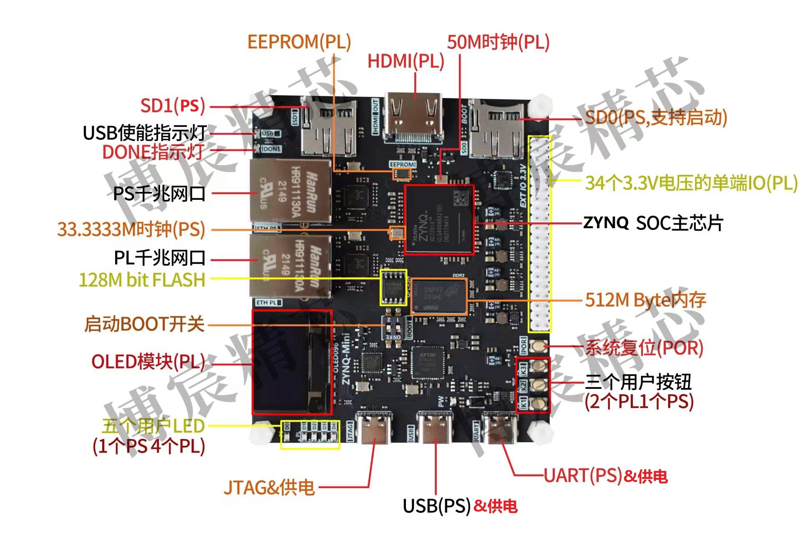

Interface labels in the photo (translated):

| Label | Meaning |
|---|---|
| EEPROM (PL) | 24C02 EEPROM on PL |
| HDMI (PL) | HDMI output on PL |
| 50M clock (PL) | 50 MHz PL oscillator |
| SD1 (PS) | TF slot 1, PS (MIO 10–15) |
| SD0 (PS, boot capable) | TF slot 0, PS (MIO 40–45) |
| USB enable LED / DONE LED | USB power-enable indicator; FPGA configuration-done indicator |
| PS Gigabit port / PL Gigabit port | RTL8211E Ethernet on PS (MIO) / on PL (BANK35) |
| 33.3333M clock (PS) | PS oscillator |
| 128M bit FLASH | W25Q128FV QSPI flash |
| BOOT switch | SW1 boot-mode DIP switch |
| OLED module (PL) | 0.96" SPI OLED |
| Five user LEDs (1 PS, 4 PL) | D6 (PS), D2–D5 (PL) |
| 34 × 3.3 V single-ended IO (PL) | 40-pin 2.54 mm header, BANK34 |
| ZYNQ SoC | XC7Z010-1CLG400 |
| 512 MByte memory | DDR3 |
| System reset (POR) | POR button |
| Three user buttons (2 PL, 1 PS) | K1 (PS), K2/K3 (PL) |
| JTAG & power / USB (PS) & power / UART (PS) & power | three Type-C connectors |

Note: JTAG, USB and UART connectors can each power the board during development. The USB connector can also supply power outward when operating as a USB host.

## 2. Power supply design

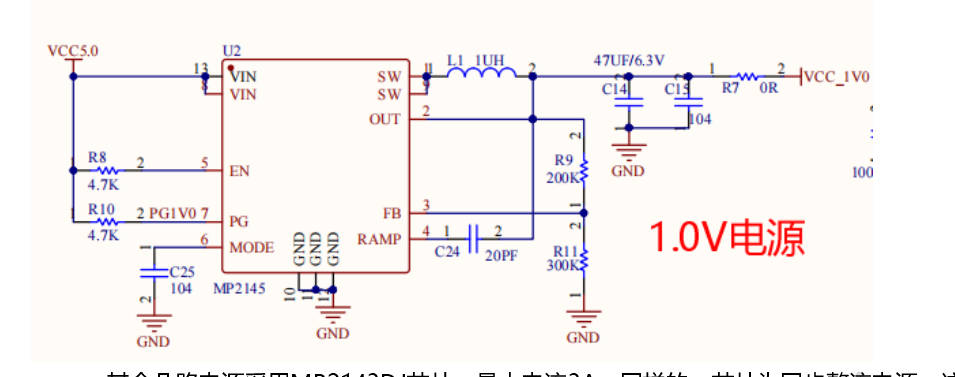

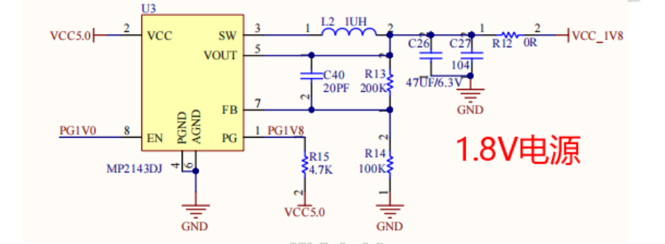

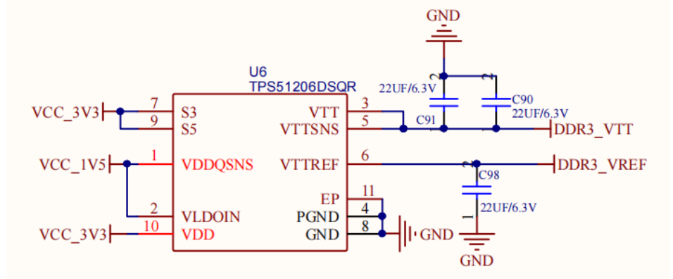

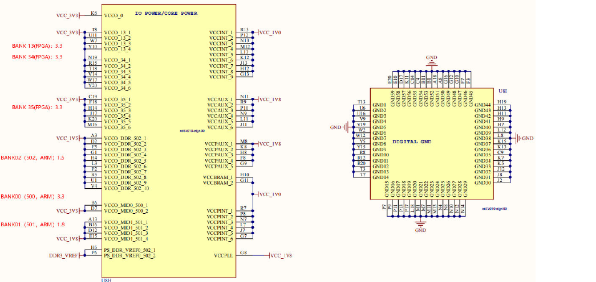

Schematic parts 1 and 2.

Five supply functions: **1.0 V** core (FPGA internal logic), **1.5 V** (DDR3 IO), **1.8 V** (VCCAUX, PLLs, 1.8 V IO), **3.3 V** (3.3 V IO), and the DDR3 termination/reference supply.

* **1.0 V core**: MP2145, synchronous-rectifier, up to **6 A**. It is separate from the other rails because the board family also ships with the 7020 (85K logic cells); with logic and clock rates pushed hard the estimated core current is 4–5 A (a 7010 needs only 2–3 A).
* **1.8 V, 1.5 V, 3.3 V**: MP2143DJ, 3 A synchronous converters (same circuit for each rail).
* **Sequencing**: Zynq requires **1.0 V → 1.8 V → 1.5 V → 3.3 V**. Each converter's PG output (pulled up to 5 V when the rail is in regulation) drives the next converter's EN. The 1.0 V converter's EN is tied high.
* **Power-on reset**: after the 3.3 V rail comes up, a **MAX809T** supervisor asserts reset to the PS **PS_POR_B** pin (BANK500, schematic part 4). When POR releases, the chip samples the boot mode and loads: QSPI boot reads flash; SD boot reads SD0. The same signal is available through the SYS RST button.
* **DDR3 reference**: TI **TPS51206** produces **VTT** and **VREF** (≈0.75 V, half of the 1.5 V input). VTT terminates the address/control lines (39 Ω pull-ups) and must source >2 A transient current; VREF is the IO reference. (Parts such as TPS51200 need two external equal resistors, e.g. 10 kΩ, to set the reference.)

**Bank supply voltages** (the voltage in constraints must match):

| Bank | Domain | Voltage |
|---|---|---|
| 13 | PL (7020 only; not connected out on this board) | 3.3 V |
| 34 | PL | 3.3 V |
| 35 | PL | 3.3 V |
| 500 | PS MIO 0–15 | 3.3 V |
| 501 | PS MIO 16–53 | 1.8 V |
| 502 | PS DDR | 1.5 V |

Internal rails: VCCPINT (PS core) 1.0 V; VCCINT (PL core) 1.0 V; VCCAUX (PL aux) 1.8 V; VCCPAUX (PS aux) 1.8 V; VCCBRAM 1.0 V; VCCPLL 1.8 V.

## 3. Clocks and boot circuit

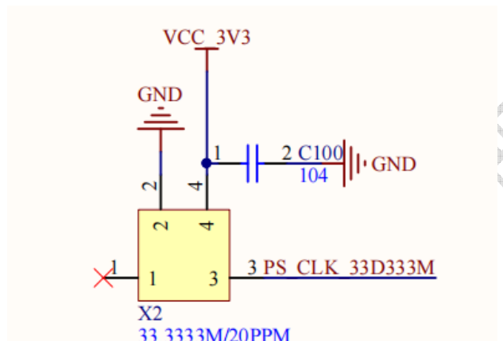

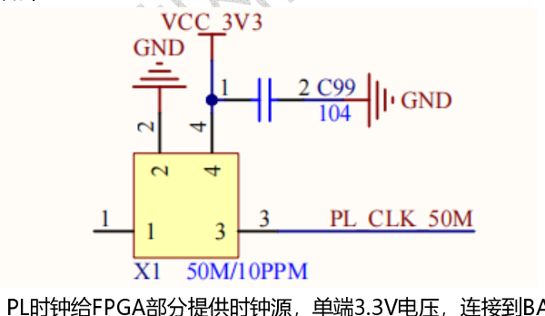

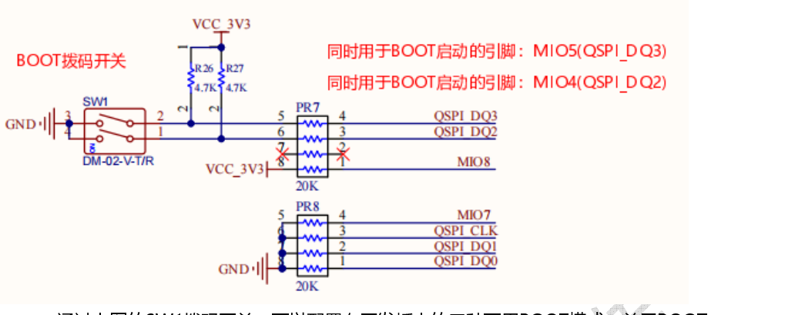

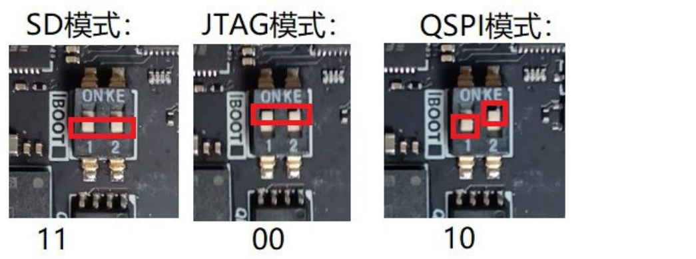

Two oscillators (schematic parts 4 and 5):

* **PS clock**: 33.3333 MHz (PS_CLK, BANK500 pin E7). [verified]
* **PL clock**: **50 MHz**, single-ended 3.3 V, to BANK35 pin **K17** (`IO_L12P_T1_MRCC_35`). In Zynq-7000, PL clock inputs must use clock-capable pins: MRCC pins reach the global clock network, SRCC pins the regional network. A single-ended oscillator must go to the **P** pin of an SRCC/MRCC pair, never the N pin; differential clocks use both P and N.

**Boot mode** (SW1, schematic part 4; silkscreen on the back of the board):

| Mode | ON KE[1:2] |
|---|---|
| JTAG | 00 |
| QSPI | 10 |
| SD card (SD0) | 11 |

The side of the switch marked "ON KE" is **0**; the side marked with the numbers 1, 2 is **1**. The boot-mode pins are shared with MIO4 (QSPI_DQ2) and MIO5 (QSPI_DQ3) (schematic part 4).

Note from the original: JTAG debugging works in any boot mode; in JTAG mode the XADC temperature can be read through the PC tool, in other modes it cannot.

## 4. Debugger and on-board UART

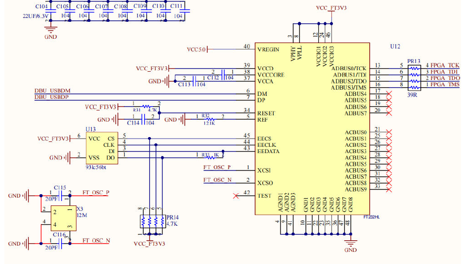

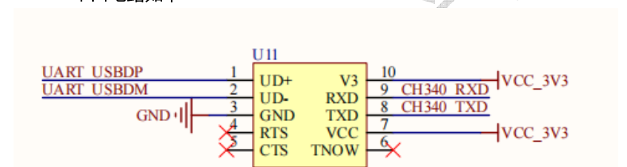

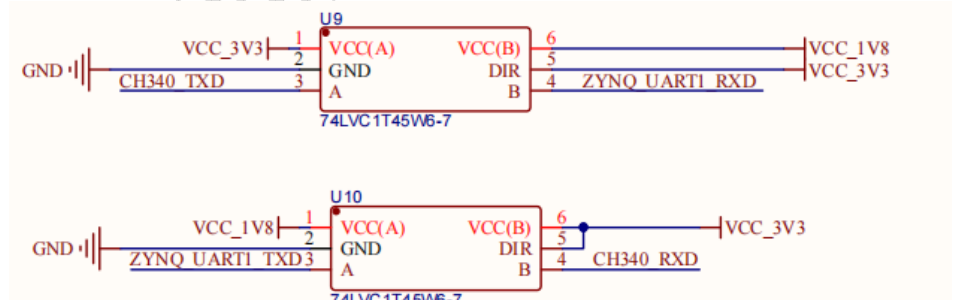

Schematic part 3.

* **JTAG**: FT232H (USB-to-JTAG).
* **UART**: CH340 USB-to-serial. The CH340 is 3.3 V but PS BANK501 is 1.8 V, so two **74LVC1T45** level translators sit in between. The UART connects to **MIO48/MIO49 = PS UART1**.

## 5. DDR3

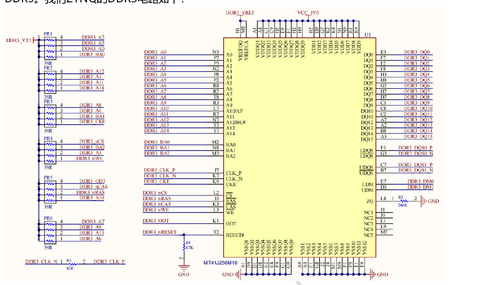

Schematic part 6. DDR3 is used by the PS only, on BANK502. The board carries a single **MT41J256M16HA-125** (256M × 16 = 4 Gbit = 512 MByte). Address lines are pulled to VTT through 39 Ω resistors (optional for a single chip, kept for stability).

**Important:** because there is only one 16-bit DDR3 device, the PS DDR configuration must be **16-bit**. The default is 32-bit and will not run unless changed. (Vendor projects use the Vivado part `MT41J256M16 RE-125`, 16 Bit, 533.33 MHz, DDR3_1066F.) [verified]

## 6. Gigabit Ethernet

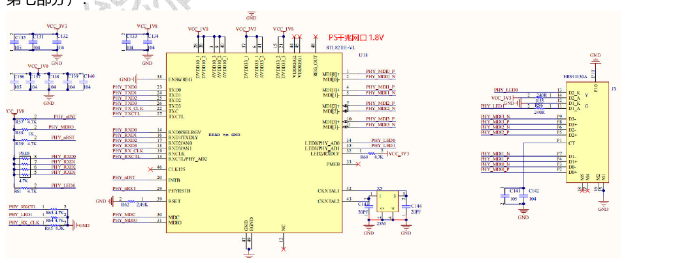

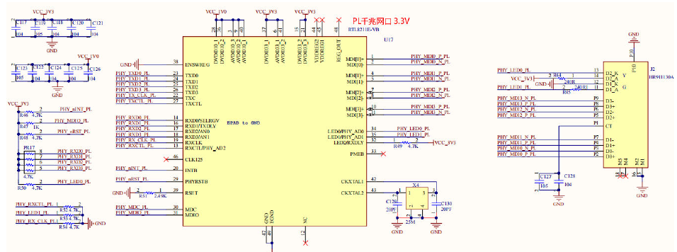

Schematic part 7. One **RTL8211E-VL** (PS) and one **RTL8211E-VB** (PL); both 1000BASE-T through HR911130A magnetics/RJ45, each with a 25 MHz crystal.

* **PS Ethernet**: RGMII on BANK501 **MIO16–27**, at **1.8 V**; MDIO/MDC on MIO52/53. [verified]
* **PL Ethernet**: on BANK35, at **3.3 V**, RGMII-class pins (see pin table in §12).

## 7. Storage

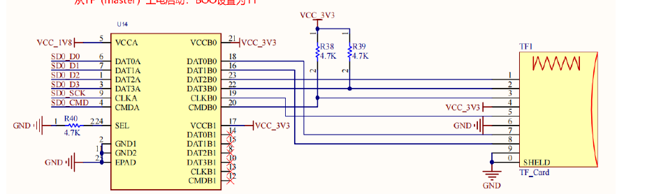

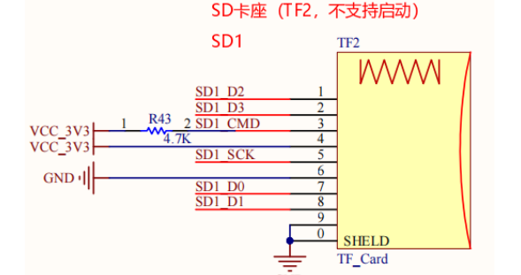

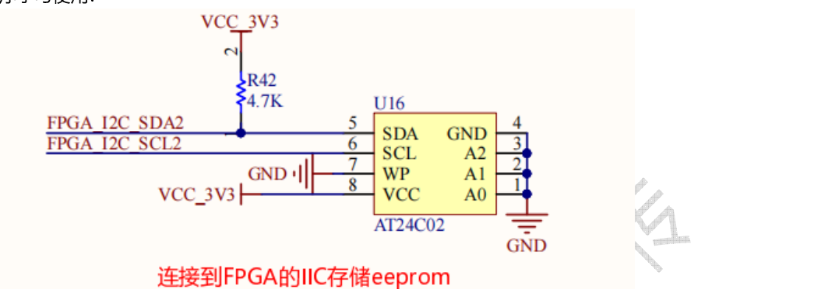

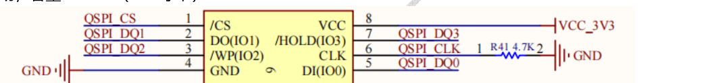

Schematic part 8.

* **DDR3**: see §5.
* **SD0 (TF)**: PS **MIO40–45** on BANK501 (1.8 V). TF cards run at 3.3 V so a **TXS02512**-class SD-specific level translator (the schematic part 8 drawing and the bundled datasheet `TXS02612RTWR.pdf` identify the fitted device as **TXS02612RTWR**, so "TXS02512" in the text is most likely a typo; TF1 is the "master" slot that supports boot, BOOT = 11) is used. No CD/WP detect lines. Supports boot.
* **SD1 (TF2)**: PS **MIO10–15** on BANK500 (3.3 V); no translator required.
* **EEPROM**: 24C02 on the PL (BANK35): **SDA = F20, SCL = F19** (useful for I²C timing practice).
* **QSPI flash**: W25Q128FV, 128 Mbit (16 MByte), PS **MIO1–6** on BANK500; used for QSPI boot.

## 8. Expansion IO, LEDs and buttons

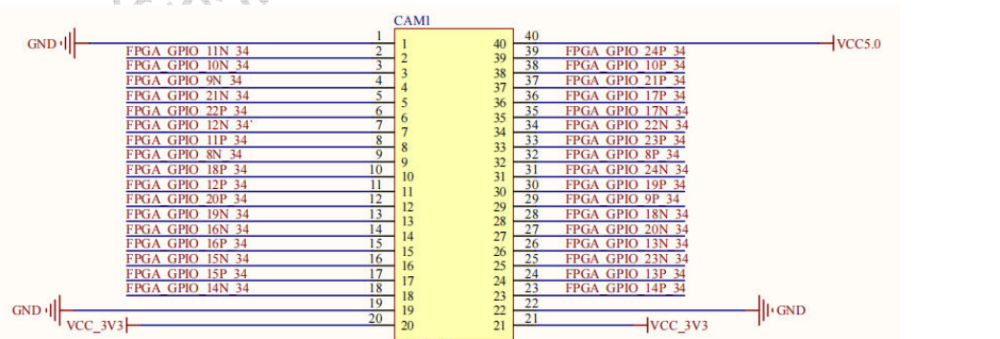

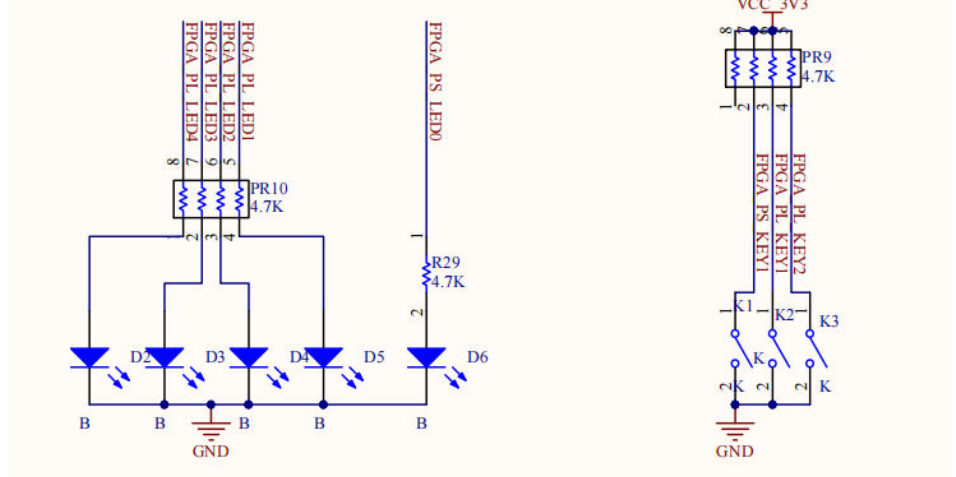

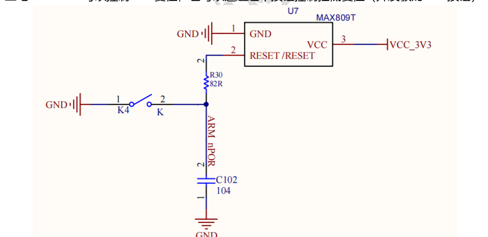

Schematic part 9.

* **40-pin 2.54 mm header**, 3.3 V, on BANK34. 34 single-ended signals, length-matched to 1615 mil ± 1 mil, suitable for single-ended expansion experiments. Pin assignments are given by the back-side silkscreen (table below).
* **LEDs**: four PL LEDs on BANK34: **LED1 → T12, LED2 → U12, LED3 → V12, LED4 → W13**. One PS LED on **MIO9**. All LEDs are **active high** (signal → 4.7 kΩ → LED → GND). [verified from schematic]
* **Buttons**: PS button **KEY1 → MIO0** (BANK500). PL buttons **KEY2 (PL_KEY1) → M20**, **KEY3 (PL_KEY2) → M19** (BANK35). All buttons pull up to 3.3 V and close to GND, i.e. **active low**. [verified from schematic]
* **POR button** (silkscreen "SYS RST"): schematic part 3, pulls the MAX809T reset line low to reset the PS.

**Expansion header pin map** (pin numbers follow the schematic's CAM1 symbol: 1–20 down one side, 21–40 down the other; the physical 2×20 header is the silkscreen row/ball table below — from `figures/board_back_silkscreen.jpg`, cross-checked against schematic part 9; right column = header pins 1–20 top to bottom, left column = pins 40–21 top to bottom):

| Row | Left (pin) | Left ball | Right (pin) | Right ball |
|---|---|---|---|---|
| 1 | 40 | +5.0 V | 1 | GND |
| 2 | 39 | P15 | 2 | U15 |
| 3 | 38 | V15 | 3 | W15 |
| 4 | 37 | V17 | 4 | U17 |
| 5 | 36 | Y18 | 5 | V18 |
| 6 | 35 | Y19 | 6 | W18 |
| 7 | 34 | W19 | 7 | U19 |
| 8 | 33 | N17 | 8 | U14 |
| 9 | 32 | W14 | 9 | Y14 |
| 10 | 31 | P16 | 10 | V16 |
| 11 | 30 | R16 | 11 | U18 |
| 12 | 29 | T16 | 12 | T17 |
| 13 | 28 | W16 | 13 | R17 |
| 14 | 27 | R18 | 14 | W20 |
| 15 | 26 | P19 | 15 | V20 |
| 16 | 25 | P18 | 16 | U20 |
| 17 | 24 | N18 | 17 | T20 |
| 18 | 23 | N20 | 18 | P20 |
| 19 | 22 | GND | 19 | GND |
| 20 | 21 | +3.3 V | 20 | +3.3 V |

Schematic net names `FPGA_GPIO_nP_34` / `FPGA_GPIO_nN_34` (n = 8…24) correspond to the `IO_L<n>P/N_T*_34` balls (e.g. header pin 2 = `FPGA_GPIO_11N_34` = U15).

## 9. USB

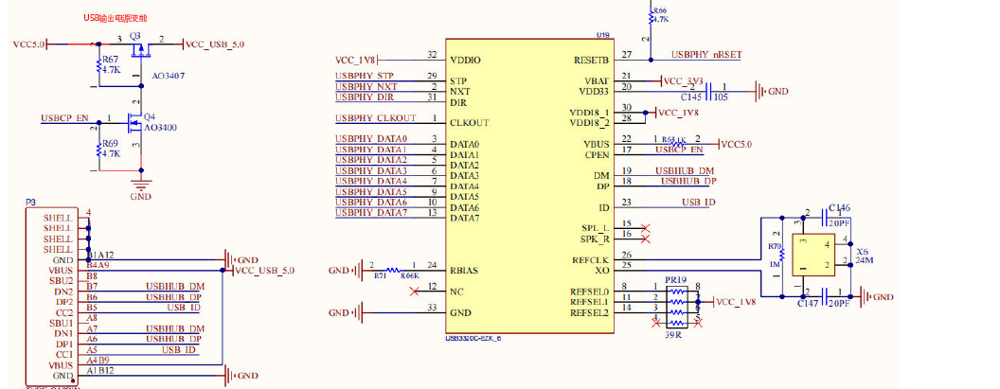

Schematic part 10. This is the USB-C connector in the middle of the three, not the JTAG/UART ones; it is the PS USB 2.0 controller. Older board versions had a hub and supported host only; this version supports **both host and device**. Examples: host role for USB cameras/keyboards/mice under Linux (e.g. PYNQ); device role to appear as a storage device to a PC.

* ULPI PHY **USB3320**, connected to BANK501 **MIO28–39** (1.8 V). PHY reset: **MIO46**. [verified]
* The Type-C port can also **power the board**: the supply gating uses two MOSFETs, and the reverse body diode of the AO3407 lets power flow in from USB (not out). Output power is enabled only when the USB3320 is running and drives CPEN high — e.g. with the board powered through JTAG/UART, the port can power a USB stick through a Type-C-to-A adapter. For more host ports use an external Type-C hub module.

## 10. HDMI

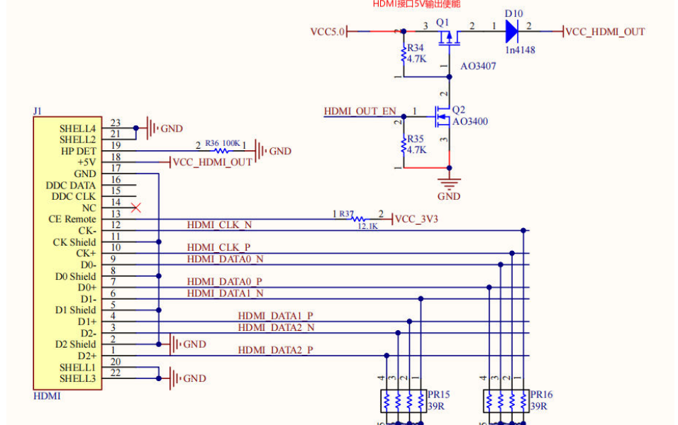

Schematic part 11. **Output only.** The HDMI +5 V is gated by two MOSFETs (controlled by HDMI_OUT_EN); once 5 V is presented, the monitor starts parsing the signal. TMDS pairs go directly to BANK35 pins using the FPGA's 3.3 V TMDS standard; this **requires external pull-ups to 3.3 V of about 50 Ω — 39 Ω is used here**.

| Signal | Ball |
|---|---|
| HDMI_CLK_P / N | H16 / H17 |
| HDMI_DATA0_P / N | D19 / D20 |
| HDMI_DATA1_P / N | C20 / B20 |
| HDMI_DATA2_P / N | B19 / A20 |
| HDMI_OUT_EN | H18 |

(The vendor `hdmi.xdc` also constrains `HDMI_HPD` to E18, but E18 is OLED_D0 on this board and HDMI is output-only; that line is not valid for this board.)

## 11. OLED

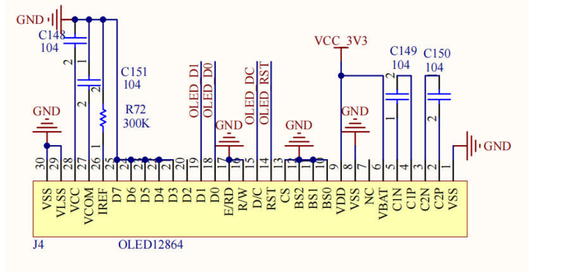

Schematic part 12. A 0.96" SPI OLED module on PL BANK35 (for simple graphics/text, or for learning OLED timing in the FPGA):

| Signal | Ball |
|---|---|
| OLED_D0 (clock) | E18 |
| OLED_D1 (data) | E19 |
| OLED_DC | F16 |
| OLED_RST | F17 |

### 11.1 OLED module notes (from the module's own manual, 中景园电子 0.96" OLED V2.0)

* 128 × 64 pixel panel, driver **SSD1306** with built-in charge pump (8 pages × 128 bytes). Variants: yellow/blue, white, blue.
* The bare panel supports 6800/8080 parallel, 3/4-wire SPI and I²C, selected by BS0–BS2. This board's module is configured as **SPI** (BS0–BS2 = 0; resistors R1, R2, R8 not fitted). For I²C, BS1 = 1, BS0 = 0.
* Module pins: GND, VCC (3–5.5 V), D0 (clock in SPI and I²C), D1 (data in SPI and I²C), RES (active-low reset), DC (data/command), CS (chip select; tied low on this board).
* Porting from the 1.3" SSD1106 panel: that controller has 132 bytes per page, so shift the display address right by 2 or the right 4 columns show wrongly.

## 12. Pin summary (PL side)

| Function | Signal | Ball | Standard | Source |
|---|---|---|---|---|
| PL clock 50 MHz | `PL_CLK_50M` | K17 | LVCMOS33 | spec, XDC |
| LED1–4 | | T12, U12, V12, W13 | LVCMOS33 | spec, XDC |
| KEY2 / KEY3 | `PL_KEY1/2` | M20 / M19 | LVCMOS33 | spec, XDC |
| EEPROM | SDA / SCL | F20 / F19 | LVCMOS33 | spec, XDC |
| OLED | D0 D1 DC RST | E18 E19 F16 F17 | LVCMOS33 | spec, XDC |
| HDMI | see §10 | | TMDS_33 | spec, XDC |
| PL Ethernet (RGMII) | `RGMII_RESET` | G17 | LVCMOS33 | vendor lwip/Linux XDC |
| | MDC / MDIO | G18 / G19 | LVCMOS33 | vendor XDC |
| | TXC / TX_CTL | J14 / K14 | LVCMOS33 | vendor XDC |
| | TXD[0..3] | N16, J19, H20, N15 | LVCMOS33 | vendor XDC |
| | RXC / RX_CTL | L16 / L17 | LVCMOS33 | vendor XDC |
| | RXD[0..3] | L20, K19, J18, J20 | LVCMOS33 | vendor XDC |
| Camera (OV5640 example) | PCLK, HREF, VSYNC, SCL, SDA, RESET | U20, N18, T20, T16, V16, N20 | LVCMOS33 | vendor XDC |
| | DATA[0..7] | P18, W16, R17, T17, R18, P19, U18, R16 | LVCMOS33 | vendor XDC |

PS MIO summary:

| Peripheral | MIO | Bank/voltage |
|---|---|---|
| KEY1 | 0 | 500 / 3.3 V |
| QSPI flash | 1–6 | 500 / 3.3 V |
| LED D6 | 9 | 500 / 3.3 V |
| SD1 | 10–15 | 500 / 3.3 V |
| PS Ethernet RGMII | 16–27 | 501 / 1.8 V |
| USB ULPI | 28–39 | 501 / 1.8 V |
| SD0 | 40–45 | 501 / 1.8 V |
| USB PHY reset | 46 | 501 / 1.8 V |
| UART1 | 48–49 | 501 / 1.8 V |
| Ethernet MDIO | 52–53 | 501 / 1.8 V |

---

## Appendix A. Schematic section titles (translated)

| Sheet | Original title | Translation / notes |
|---|---|---|
| 1 | 第一部分 ZYNQ的电源系统 | Part 1 – ZYNQ power system. Rails: 1.0 V core (MP2145), 1.8 V, 1.5 V, 3.3 V (MP2143DJ), DDR3 VTT/VREF (TPS51206). Power-up order 1.0 V → 1.8 V → 1.5 V → 3.3 V |
| 2 | 第二部分 ZYNQ芯片的电源引脚 | Part 2 – ZYNQ chip power pins |
| 3 | 第三部分 ZYNQ的JTAG和调试器电路 | Part 3 – ZYNQ JTAG and debugger circuit. Power-on-reset supervisor asserts a low reset once 3.3 V is ready; UART and JTAG Type-C connectors can power the board; the PS UART is 1.8 V and is translated to 3.3 V for the CH340 |
| 4 | 第四部分 ZYNQ的PS部分BANK（仅用于ARM） | Part 4 – PS banks (ARM only): BANK501 all IO 1.8 V, BANK500 all IO 3.3 V; boot DIP switch; MIO4/MIO5 (QSPI_DQ2/DQ3) double as boot-mode pins |
| 5 | 第五部分 ZYNQ的PL部分的BANK（FPGA部分） | Part 5 – PL banks; 50 MHz oscillator for the PL |
| 6 | 第六部分 ZYNQ的PS部分的DDR3 | Part 6 – PS DDR3. Layout notes: DQ/DQS/DM length-matched, DQS P/N differential; A0–A14 and control lines length-matched, terminated with 39 Ω to VTT; CLK P/N differential and matched to the address lines |
| 7 | 第七部分 ZYNQ的PL PS部分千兆网口 | Part 7 – Gigabit Ethernet for PS (1.8 V, RTL8211E-VL) and PL (3.3 V, RTL8211E-VB) |
| 8 | 第八部分 ZYNQ存储，QSPI FLASH,SD卡，EEPROM | Part 8 – Storage: TF1/SD0 (master, boot capable, BOOT = 11), TF2/SD1 (no boot), W25Q128FV QSPI (boot with BOOT = 10), AT24C02 EEPROM on the FPGA I²C |
| 9 | 第九部分 开发板对外的用户扩展34个IO口及LED和按钮 | Part 9 – 34 user expansion IOs, LEDs and buttons ("see the silkscreen on the back of the PCB, it names the ZYNQ pins directly") |
| 10 | 第十部分 开发板的USB电路 | Part 10 – USB circuit. USB output-power enable; when USB is unused or not supplying power as a device it can be a board power input — Q3 has a body diode that conducts |
| 11 | 第十一部分 HDMI电路 | Part 11 – HDMI circuit (HDMI 5 V output enable) |
| 12 | 第十二部分 PL的OLED电路 | Part 12 – PL OLED circuit |

## Appendix B. Physical design files

* `ZYNQ_MINI接口PCB.PcbDoc` – Altium PCB (binary format 5.01 / "PCB 6.0 Binary File", 23 placed components in the interface-board variant). Components include 0805 passives, the 2.54 mm two-position DIP switch, the 40-pin double-row header, HDMI SMD connector, HR911130A RJ45, OLED096 module socket, TYPE-C connectors and inset TF card sockets. Board sheet 10000 × 8000 mil.
* `ZYNQ_MINI亚克力.PcbDoc` – Altium outline for the acrylic cover (no components).
* `ZYNQ_MINI亚克力CAD加工文件.DWG` – AutoCAD 2013–2017 (AC1027) drawing for CNC/laser cutting the acrylic cover.
* `ZYNQ_MINI_REVB器件丝印.pdf` – single-sheet component-placement silkscreen drawing: shows the connector order along the bottom edge (JTAG, USB, UART), keys K1–K3 and POR on the left, LEDs D0–D4 at the top, OLED096 right, BOOT switch, QFLASH, DDR3, EEPROM, HDMI OUT, SD0/SD1, ETH PS and ETH PL, and EXT IO 3.3 V.

These are proprietary CAD formats; only their metadata and silkscreen were read, not routed copper.

## Appendix C. Example-project catalogue (`03例程工程/7010`, Vivado/SDK 2018.3, xc7z010clg400-1)

| Archive | Projects |
|---|---|
| ARM部分 (ARM) | 01 UART hello world · 02 MIO in/out · 03 AXI GPIO in/out · 04 AXI GPIO interrupt · 05 RTOS multi-task · 06 SD card FatFs · 07 UART echo · 08 dual-A9 AMP · 09 read/write flash · 10 timer interrupt · 11 PS XADC · 12 FatFs on SD1 (the flip-lid TF slot) · 13 lwIP · 14 TCP flash update |
| ARM+FPGA部分 | 01 custom GPIO IP · 02 simple register read/write · 03 custom PWM · 04 HDMI output · 05 AXI PL-write/PS-read · 06 BRAM PL-write/PS-read · 07 XADC · 08 PL OLED · 09 PL lwIP · 10 HDMI SD bitmap · 11 OV5640 camera · 12 dual OV5640 |
| FPGA逻辑部分 | 01 LED stream · 02 breathing LED · 03 FPGA flash download · 04 PLL clock · 05 I²C EEPROM · 06 FIFO/ILA debug · 07 single-ended to differential · 08 UART echo · 09 FIFO mark-debug · 10 VGA/HDMI test · 11 RAM read/write · 12 PL read/write of the PS DDR3 · 13 AXI simulation · 14 PL Ethernet MDIO · 15 Ethernet UDP echo |
| HLS部分 | 01 LED-stream IP · 02 FIR filter IP · 03 FIR with ModelSim · 04 image-processing intro · 05 floating-point sum/mean co-processor · 06 camera image convolution (Sobel) |
| LINUX部分 | 01 PetaLinux 2018.3 boot · 02 Linux with graphical desktop (1920×1080 HDMI) · 03 USB gadget (mass-storage) |
| MIcroblaze开源处理器 | 01 MicroBlaze hello world · 02 MicroBlaze UART printf |
| PYNQ开发部分 | 01 porting/building PYNQ on Zynq · 02 hello world · 03 GPIO · 04 HLS AXI-Lite multiplier · 05 HLS Sobel · 06 USB-camera face detection |

Notes from the vendor `.txt` files (translated):
* ARM: "Projects that use the PS: rebuild the SDK project following the tutorial, otherwise the C code cannot find its paths." Project 12 uses **SD1 (the flip-lid TF slot)**.
* FPGA 12 (DDR3): the PL reads/writes the PS DDR3 over AXI; keep the on-line debug (ILA) signals; the SDK test project must be run with "program FPGA" ticked because clocks and resets exist only once the processor has started; refresh the device in Vivado afterwards; extract the project near the root of C:.
* FPGA 14: PL Ethernet MDIO example; with a gigabit cable to a PC, two of the four FPGA LEDs light to show a gigabit link.
* FPGA 15: set the PC to 192.168.1.3 and use a UDP debug tool; the example was written for two ports (ETH1/ETH2) and its constraints are in the stale, wrong-device pin block mentioned below.
* HLS 04: create a new HLS project, choose the device for your own board, add the .cpp/.h as sources and tb.cpp as the testbench.
* OV5640 camera: re-map pins if a different vendor's module is used; **do not plug the module into the expansion header backwards** (short-circuit risk); copy the project to a disk root.
* PYNQ 06: needs a UVC (driver-free) 720p USB camera.
* Linux USB-gadget test: mount the SD card, `insmod libcomposite.ko` and `usb_f_mass_storage.ko`, create a 200 MB backing file, configure a `mass_storage.ms0` function under configfs and bind UDC `ci_hdrc.0`. Device trees set `dr_mode = "host"` (desktop example) or `"peripheral"` (gadget) with a ULPI PHY.

## Appendix D. Bundled datasheets (`芯片手册相关.zip`)

All are the manufacturers' own English documents and need no translation. Zynq: DS187 (XC7Z010/20), DS190, DS191, UG585 (TRM, 1845 pp.), UG821, UG865 (package pinout), UG933 (PCB guide), UG480 (XADC), PG054, UG476. 7-series: DS180–DS182, UG429, UG470, UG471, UG472, UG474, UG475, UG479, UG586, product guides. Peripherals fitted on the board: MT41J256M16 (DDR3), W25Q128FV, RTL8211E, USB3320C, FT232H, CH340, MAX809T, MP2145, MP2143DJ, TXS02612RTWR, 74LVC1T45, AO3400, 24LC04B-family EEPROM (the schematic shows an AT24C02).

## Appendix E. Other files in the vendor package

| Path | Content |
|---|---|
| `01开发板硬件资料/oled模块资料/` | OLED module manual (translated in §11.1), SSD1306 and panel specs, I²C/SPI schematics, demo code, PCtoLCD2002 font-extraction tool and tutorial |
| `08常用引脚约束文件/*.xdc` | Common constraint files (clock, LED stream, Ethernet loopback, HDMI, OLED, OV5640+HDMI) |
| `03例程工程/用到PS建议按教程重建SDK工程，否则c代码找不到路径.txt` | See Appendix C |

**Caution on the vendor constraint files:** `eth_loopback.xdc` and the project `fpga_15_eth_udp_eco` contain a stale block of assignments (T26, AH26, AJ27, AB28, AG29, …) belonging to a different, larger device; those balls do not exist on the CLG400 package. Only the later block (G17, G18, G19, J14, …) is valid. Likewise `fpga_05_pl_iic_eeprom` has an older intermediate constraint using G17/G18 for I²C; the final one uses SDA = F20, SCL = F19, which matches the schematic. `clock.xdc` declares `phy_rxc` with an 8 ns period (125 MHz RGMII receive clock at 1 Gbps).

## Appendix F. Additional details found in the tutorial sources

Findings from a pass over the hand-written HDL, C, HLS, Python and device-tree sources of the example projects (about 270 files, excluding Xilinx-generated IP/BSP code and multi-megabyte image arrays) and over the 13 tutorial PDFs bundled in the projects. Items are new relative to the spec, schematic and constraint files, unless marked "confirms".

| Topic | Finding | Source |
|---|---|---|
| DDR3 size | The linker scripts place DDR at `0x00100000` with length `0x1FF00000`; with the first 1 MiB reserved this is the full **512 MiB** window. **Confirms** the 512 MByte printed on the board photo and the 4 Gbit x16 part | `lscript.ld` in the ARM projects |
| PS user key / LED | `PS_KEY_MIO = 0`, `PS_LED1_MIO = 9`. **Confirms** KEY1 = MIO0 and LED D6 = MIO9 | `arm_02_mio_inout` `helloworld.c` |
| PL PHY MDIO address | The PL RTL8211E answers at **PHY address 1** (`PHY_ADDR = 5'b00001`). PHY-register reads give link/speed (`01` = 10 M, `10` = 100 M, `11` = 1000 M); two of the four LEDs light on a gigabit link | `mdio_driver.v`, `mdio_read_write.v`, `fpga_14` notes |
| PL RGMII receive path | Uses IDELAY on RXD/RX_CTL with a **200 MHz** IDELAYCTRL reference clock (`REFCLK_FREQUENCY = 200.0`), so a 200 MHz clock must be generated in the design. RX clock is constrained at 8 ns (125 MHz) | `rgmii_rxd.v`, `clock.xdc` |
| Provenance of the Ethernet example | `rtl8211e_mdio.v` still carries the header "kintex 7 ECO development board" — the example was ported from an older board, which explains the stale Kintex pin block in the XDC files | `rtl8211e_mdio.v` |
| Default network settings | UDP example: MAC `12:34:56:78:90:ab`, IP `192.168.1.10`, UDP port 1234 (PC set to 192.168.1.3). lwIP examples: IP `192.168.1.5`, MAC `00:0a:35:00:01:02`. TCP flash-update server: port **8080**, files up to **16 MB** (the whole W25Q128 flash) | `udp_top.v`, `udp_txd.v`, lwIP `main.c`, `qspi_remote_update.h` |
| HDMI limits | Comment in the video-mode table (written for a 7035 variant, where HDMI is on an HR bank limited to 1200 Mbit/s per lane): 1080p60 is not supported and **"this board's HDMI supports at most 1920×1080 @ 50 Hz"**; the TMDS pins here are likewise on HR-bank BANK35, so treat 1080p50 as the practical limit (720p60 and 1080p50/30 are provided). Pixel clock 74.25 MHz, serial clock ×5 (371.25 MHz) in the TMDS encoder | `vga_modes.h`, `hdmi_encoder_top.v` |
| HDMI hot-plug detect | `hdmi.xdc` and the Linux project constrain `HDMI_HPD` to E18, but E18 is OLED_D0; the schematic ties HP DET to ground through 100 kΩ, so HPD is **not** wired to the FPGA | schematic part 11, `zynq_linux_desktop.xdc` |
| Dual camera (OV5640) pinout on the expansion header | Camera 0: PCLK U20, VSYNC T20, HREF N18, RESET N20, D[7:0] = R16, U18, P19, R18, T17, R17, W16, P18. Camera 1: PCLK Y14, VSYNC W14, HREF Y18, RESET W18, D[7:0] = P15, V18, V17, V15, U19, W19, Y19, U17. SCCB (I²C) is bit-banged through **PS EMIO GPIO 54–57** (SDA0 = 54, SCL0 = 55, SCL1 = 56, SDA1 = 57); matching the `emio_sccb_tri_io[0..3]` pins in order gives SDA0 = V16, SCL0 = T16, SCL1 = W15, SDA1 = U15 (the V16/T16 pair also matches the single-camera XDC). OV5640 8-bit write address `0x78`, 24 MHz input, 72 MHz pixel clock, RGB565 output. The project sets `CLOCK_DEDICATED_ROUTE FALSE` for the camera pixel clock because it is not on a clock-capable pin | `top_pin.xdc`, `ov5640_reg_conf.h`, `ov5640_init.c` |
| Header pins used as a UART | The `uart_eco` and MicroBlaze examples use an external USB-UART on the header: **RXD = P15, TXD = U15**. (The on-board USB-UART goes to the PS, not the PL) | `uart_eco.xdc`, `microblaze.xdc` |
| Examples written for a 4-key board | Several C examples print "Press PL KEY1 ~ KEY4" and read `& 0x0F`; this board has only **two** PL keys (M20 and M19) plus the PS key. The XDCs bind a single key (M19) to the GPIO input | `helloworld.c` (arm_03/04/05) |
| XADC | The PS XADC example reads on-chip temperature and VCCINT, VCCAUX, VBRAM, VCCPINT, VCCPAUX, VCCPDRO — useful for checking the rails, no board-specific wiring needed | `arm_11_ps_xadc` |
| Linux USB | Device trees set the ULPI PHY at `0xE0002000` with `drv-vbus`; `dr_mode` is `host` for the desktop image and `peripheral` for the mass-storage gadget. **Confirms** USB host/device support | `system-user.dtsi` |
| Tutorial PDFs | The 13 PDFs inside the projects (AXI reference guide UG1037, AXI VDMA PG020, Video-out PG044, AXI4-Stream infrastructure PG085, Video Timing Controller PG016, rgb2dvi) are generic Xilinx/IP documentation; none mention this board. They need no translation | — |

None of these findings changes the board files: they affect usage notes, not pin or PS settings. The HDMI 1080p50 limit and the 200 MHz IDELAYCTRL requirement are the two items most likely to trip up a new design.
